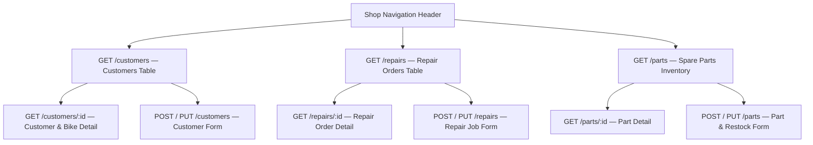

# Week 2 — Screen Wireframes (Deliverable 1: Scoping & Wireframes)

**Prepared by:** Dagala (Scribe), Cabatingan (Board Lead), and Alvin Murillo (Repo Lead)

---

## Screen 1: Customers & Motorcycles View (`customers` CRUD — Owner: Alvin Murillo)

```text
+-----------------------------------------------------------------------------------+
|  MOTORCYCLE REPAIR SHOP SYSTEM        [Customers]   [Repair Orders]   [Parts]     |
+-----------------------------------------------------------------------------------+
|  CUSTOMERS & MOTORCYCLES               [Search by Plate: _______] [+ New Customer]|
+-----------------------------------------------------------------------------------+
|  ID  | Customer Name     | Phone        | Plate No. | Motorcycle Model | Actions  |
|------+-------------------+--------------+-----------+------------------+----------|
|  #1  | Juan Dela Cruz    | 09171234567  | ABC-1234  | Honda Click 125i | [View]   |
|      |                   |              |           |                  | [Edit]   |
|      |                   |              |           |                  | [Delete] |
|------+-------------------+--------------+-----------+------------------+----------|
|  #2  | Maria Santos      | 09187654321  | XYZ-9876  | Yamaha NMAX 155  | [View]   |
|      |                   |              |           |                  | [Edit]   |
|      |                   |              |           |                  | [Delete] |
+-----------------------------------------------------------------------------------+

  +--- [Modal: Create / Edit Customer (POST /customers, PUT /customers/:id)] -----+
  |  Customer Name*:    [ Juan Dela Cruz               ] (1-80 chars)             |
  |  Phone Number*:     [ 09171234567                  ] (7-15 digits)            |
  |  Plate Number*:     [ ABC-1234                     ] (Format: XXX-1234)       |
  |  Motorcycle Model*: [ Honda Click 125i             ] (2-80 chars)             |
  |                                                                               |
  |  [ ! Error Banner (422): "plateNumber format is invalid" (field: plateNumber)]|
  |                                                     [ Cancel ]  [ Save (201) ]|
  +-------------------------------------------------------------------------------+
```

---

## Screen 2: Repair Job Orders View (`repairs` CRUD — Owner: Cabatingan)

```text
+-----------------------------------------------------------------------------------+
|  MOTORCYCLE REPAIR SHOP SYSTEM        [Customers]   [Repair Orders]   [Parts]     |
+-----------------------------------------------------------------------------------+
|  REPAIR JOB ORDERS                        Filter: [All Statuses v] [+ New Job]    |
+-----------------------------------------------------------------------------------+
|  ID  | Customer (#ID)  | Issue Reported          | Mechanic | Labor (PHP) | Status|
|------+-----------------+-------------------------+----------+-------------+-------|
|  #1  | Juan (#1)       | Full CVT cleaning & oil | Berto    | PHP 850.00  | [paid]|
|      | Actions: [View] [Edit] [Update Status] [Delete (Owner Only)]               |
|------+-----------------+-------------------------+----------+-------------+-------|
|  #2  | Maria (#2)      | Front brake pad replace | Dante    | PHP 450.00  | [pend]|
|      | Actions: [View] [Edit] [Update Status] [Delete (Owner Only)]               |
+-----------------------------------------------------------------------------------+

  +--- [Modal: Create / Edit Repair Order (POST /repairs, PUT /repairs/:id)] -----+
  |  Customer ID*:      [ 1 - Juan Dela Cruz (ABC-1234) v ] (Must exist)          |
  |  Reported Issue*:   [ Front brake pad replacement     ] (5-200 chars)         |
  |  Assigned Mechanic*:[ Dante                           ] (2-60 chars)          |
  |  Labor Cost (PHP)*: [ 450                             ] (0 - 100,000)         |
  |  Job Status*:       (o) pending  ( ) in_progress  ( ) completed  ( ) paid     |
  |                                                                               |
  |  [ ! Error Banner (422): "laborCost out of range" (field: laborCost) ]        |
  |                                                     [ Cancel ]  [ Save (201) ]|
  +-------------------------------------------------------------------------------+
```

---

## Screen 3: Spare Parts Inventory View (`parts` CRUD — Owner: Dagala)

```text
+-----------------------------------------------------------------------------------+
|  MOTORCYCLE REPAIR SHOP SYSTEM        [Customers]   [Repair Orders]   [Parts]     |
+-----------------------------------------------------------------------------------+
|  SPARE PARTS INVENTORY                   Category: [All v]       [+ Add New Part] |
+-----------------------------------------------------------------------------------+
|  ID  | SKU       | Part Name               | Category   | Qty | Unit Price | Act. |
|------+-----------+-------------------------+------------+-----+------------+------|
|  #1  | OIL-10W40 | Synthetic Scooter Oil   | lubricants |  25 | PHP 320.00 | [Ed] |
|      |           |                         |            |     |            | [+Qt]|
|      |           |                         |            |     |            | [Del]|
|------+-----------+-------------------------+------------+-----+------------+------|
|  #2  | BRK-NMAXF | Ceramic Brake Pads NMAX | brakes     |  12 | PHP 550.00 | [Ed] |
|      |           |                         |            |     |            | [+Qt]|
|      |           |                         |            |     |            | [Del]|
+-----------------------------------------------------------------------------------+

  +--- [Modal: Add / Edit Spare Part (POST /parts, PUT /parts/:id)] --------------+
  |  Part Name*:   [ Synthetic Scooter Oil 1L       ] (2-100 chars)               |
  |  SKU Code*:    [ OIL-10W40                      ] (3-20 uppercase/digits/-)   |
  |  Category*:    [ lubricants                   v ] (engine|brakes|electrical|  |
  |                                                    tires|lubricants|body)     |
  |  Stock Qty*:   [ 25                             ] (0 - 999)                   |
  |  Unit Price*:  [ 320                            ] (1 - 100,000 PHP)           |
  |                                                                               |
  |  [ ! Error Banner (422): "qty out of range" (field: qty) ]                    |
  |                                                     [ Cancel ]  [ Save (201) ]|
  +-------------------------------------------------------------------------------+
```

---

## Screen Flow Diagram


